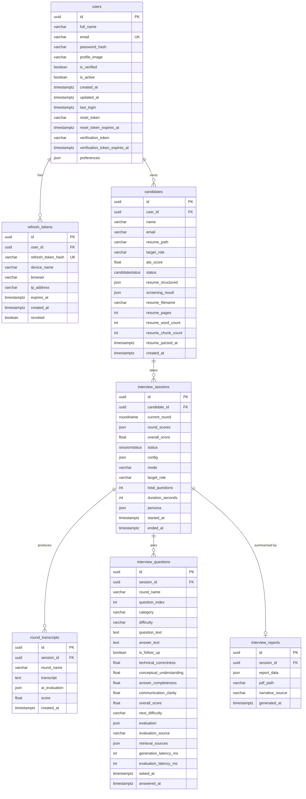

# Database Schema — Callback Rehearsal / InterviewAI

Source of truth: `backend/core/models.py` (SQLAlchemy 2.0 declarative models), `backend/alembic/versions/*.py`
(migrations) and the `POSTGRES_MIGRATIONS` list in `backend/main.py`.

```
users ─┬─< refresh_tokens
       └─< candidates ─< interview_sessions ─┬─< round_transcripts
                                             ├─< interview_questions
                                             └── interview_reports (1:1)
```

## Contents

1. [Engines and type mapping](#1-engines-and-type-mapping)
2. [Enums](#2-enums)
3. [Tables](#3-tables)
4. [Relationships, cascades and indexes](#4-relationships-cascades-and-indexes)
5. [Entity–relationship diagram](#5-entityrelationship-diagram)
6. [JSON column structures](#6-json-column-structures)
7. [Migration strategy](#7-migration-strategy)
8. [Timezone handling](#8-timezone-handling)
9. [Example queries](#9-example-queries)

---

## 1. Engines and type mapping

| Setting | Value |
|---|---|
| Production target | PostgreSQL (`asyncpg`), `DATABASE_URL=postgresql+asyncpg://...`; `postgresql://` / `postgres://` are rewritten to `+asyncpg`, and `sslmode` / `channel_binding` query params are stripped (`Settings.async_database_url`). SSL is forced for non-localhost hosts. |
| Development default | SQLite via `aiosqlite`: `sqlite+aiosqlite:///./interviewai_dev.db` |
| Tests | `sqlite+aiosqlite:///:memory:` (set in `tests/conftest.py`) |
| Pool (PostgreSQL only) | `pool_size=20, max_overflow=10, pool_timeout=30, pool_recycle=1800, pool_pre_ping=True` |

Column types as declared in the models and how they materialise:

| Declared type | PostgreSQL | SQLite |
|---|---|---|
| `UUID(as_uuid=True)` (from `sqlalchemy.dialects.postgresql`) | `UUID` | `CHAR(32)` (hex string) |
| `JSON` (`sqlalchemy.types.JSON`) | `JSON` when created by `create_all`; **`JSONB`** when created by Alembic revision `a1b2c3d4e5f6` or by `POSTGRES_MIGRATIONS` | `JSON` (text) |
| `Enum(<PyEnum>)` | native enum types `candidatestatus`, `roundname`, `sessionstatus` storing the **member names** (`UPLOADED`, `DSA`, `COMPLETED`, …) | `VARCHAR` with a CHECK constraint |
| `DateTime(timezone=True)` | `TIMESTAMPTZ` | naive `DATETIME` (see section 8) |
| `String(n)` / `Text` / `Float` / `Integer` / `Boolean` | as named | as named |

Python-side defaults (`default=uuid.uuid4`, `default=_now`, `default=False`, …) are applied by SQLAlchemy at insert time, not as database `DEFAULT`s, except where a migration added a `server_default` (noted per column below).

---

## 2. Enums

| Enum (Python) | DB type name | Values (stored name → Python value) | Used by |
|---|---|---|---|
| `CandidateStatus` | `candidatestatus` | `UPLOADED → "uploaded"`, `SCREENED → "screened"`, `INTERVIEWING → "interviewing"`, `COMPLETED → "completed"`, `REJECTED → "rejected"` | `candidates.status` |
| `RoundName` | `roundname` | `DSA → "dsa"`, `TECHNICAL → "technical"`, `HR → "hr"` | `interview_sessions.current_round` |
| `SessionStatus` | `sessionstatus` | `PENDING → "pending"`, `ACTIVE → "active"`, `COMPLETED → "completed"`, `CANCELLED → "cancelled"` | `interview_sessions.status` |

`CANCELLED` was not part of the initial revision; it is added by `ALTER TYPE sessionstatus ADD VALUE IF NOT EXISTS 'CANCELLED'` in both revision `a1b2c3d4e5f6` and `POSTGRES_MIGRATIONS`.

Candidate lifecycle: `uploaded` → (`screened` | `rejected`) → `interviewing` → `completed`. Session lifecycle: `active` (created by `POST /api/interviews/start`) → `completed` | `cancelled`. `pending` exists in the enum but is not set by any current route.

---

## 3. Tables

### 3.1 `users`

| Column | Type | Null | Default | Notes |
|---|---|---|---|---|
| `id` | UUID | no | `uuid4()` | PK |
| `full_name` | VARCHAR(255) | no | | |
| `email` | VARCHAR(255) | no | | **unique**, indexed |
| `password_hash` | VARCHAR(512) | no | | Argon2 hash |
| `profile_image` | VARCHAR(512) | yes | | URL or `/uploads/...` path |
| `is_verified` | BOOLEAN | no | `false` | set by `/api/auth/verify-email`; reset on e-mail change |
| `is_active` | BOOLEAN | no | `true` | inactive users get `403` |
| `created_at` | TIMESTAMPTZ | no | `now()` (UTC) | |
| `updated_at` | TIMESTAMPTZ | no | `now()`, `onupdate=now()` | |
| `last_login` | TIMESTAMPTZ | yes | | set on login |
| `reset_token` | VARCHAR(255) | yes | | forgot-password token (15 min) |
| `reset_token_expires_at` | TIMESTAMPTZ | yes | | |
| `verification_token` | VARCHAR(255) | yes | | e-mail verification token (24 h) |
| `verification_token_expires_at` | TIMESTAMPTZ | yes | | |
| `preferences` | JSON | yes | | see 6.1 |

### 3.2 `refresh_tokens`

| Column | Type | Null | Default | Notes |
|---|---|---|---|---|
| `id` | UUID | no | `uuid4()` | PK |
| `user_id` | UUID | no | | FK → `users.id` |
| `refresh_token_hash` | VARCHAR(512) | no | | SHA-256 hex of the raw token; **unique**, indexed |
| `device_name` | VARCHAR(255) | yes | | `Desktop` / `Mobile` / `Tablet` (UA sniffing) |
| `browser` | VARCHAR(255) | yes | | `Chrome` / `Safari` / `Firefox` / `Edge` / `Other` |
| `ip_address` | VARCHAR(45) | yes | | |
| `expires_at` | TIMESTAMPTZ | no | | 30 d, or 90 d with `remember_me` |
| `created_at` | TIMESTAMPTZ | no | `now()` | |
| `revoked` | BOOLEAN | no | `false` | column exists; current code **deletes** rows instead of setting it |

### 3.3 `candidates`

One uploaded resume profile owned by a user.

| Column | Type | Null | Default | Notes |
|---|---|---|---|---|
| `id` | UUID | no | `uuid4()` | PK; also the upload folder name `UPLOAD_DIR/<id>/` and the FAISS `candidate_id` metadata |
| `user_id` | UUID | yes | | FK → `users.id` (nullable for legacy rows; every route sets it) |
| `name` | VARCHAR(255) | no | | |
| `email` | VARCHAR(255) | no | | lower-cased |
| `resume_path` | VARCHAR(512) | yes | | `UPLOAD_DIR/<id>/resume.pdf|.docx` |
| `target_role` | VARCHAR(255) | yes | | |
| `ats_score` | FLOAT | yes | | 0–100 |
| `status` | ENUM `candidatestatus` | no | `UPLOADED` | |
| `resume_structured` | JSON | yes | | see 6.2 |
| `screening_result` | JSON | yes | | see 6.3 |
| `resume_filename` | VARCHAR(255) | yes | | original file name |
| `resume_pages` | INTEGER | yes | | |
| `resume_word_count` | INTEGER | yes | | |
| `resume_chunk_count` | INTEGER | yes | | chunks indexed in FAISS |
| `resume_parsed_at` | TIMESTAMPTZ | yes | | |
| `created_at` | TIMESTAMPTZ | no | `now()` | |

Constraint: `UNIQUE (user_id, email)` named `uq_candidates_user_email`. The original global `UNIQUE (email)` from revision `81db495860f2` is dropped on PostgreSQL by `a1b2c3d4e5f6` / `POSTGRES_MIGRATIONS` (`DROP CONSTRAINT IF EXISTS candidates_email_key`).

### 3.4 `interview_sessions`

| Column | Type | Null | Default | Notes |
|---|---|---|---|---|
| `id` | UUID | no | `uuid4()` | PK |
| `candidate_id` | UUID | no | | FK → `candidates.id` |
| `current_round` | ENUM `roundname` | no | `DSA` | round the session is currently in (not advanced to anything after the last round; `status` says `completed`) |
| `round_scores` | JSON | yes | | `{dsa?, technical?, hr?}` each 0–100 |
| `overall_score` | FLOAT | yes | | mean of `round_scores` values, 0–100 |
| `status` | ENUM `sessionstatus` | no | `PENDING` (model); routes create `ACTIVE` | |
| `config` | JSON | yes | | normalised interview configuration, see 6.4 |
| `mode` | VARCHAR(20) | yes | | `voice` \| `text` |
| `target_role` | VARCHAR(255) | yes | | |
| `total_questions` | INTEGER | yes | | incremented per finalised round (questions answered / DSA submissions) |
| `duration_seconds` | INTEGER | yes | | `ended_at − started_at`, computed on completion |
| `persona` | JSON | yes | | `{name, description}` snapshot of the interviewer persona |
| `started_at` | TIMESTAMPTZ | no | `now()` | |
| `ended_at` | TIMESTAMPTZ | yes | | set on completion or cancellation |

Rows are also created by `POST /api/practice/save` (status `completed`, `current_round=HR`, no `config`, no questions).

### 3.5 `round_transcripts`

Round-level transcript and aggregate evaluation. Multiple rows per session; DSA rounds write one row **per submission** plus one summary row.

| Column | Type | Null | Default | Notes |
|---|---|---|---|---|
| `id` | UUID | no | `uuid4()` | PK |
| `session_id` | UUID | no | | FK → `interview_sessions.id` |
| `round_name` | VARCHAR(50) | no | | free text: `dsa` \| `technical` \| `hr` |
| `transcript` | TEXT | yes | | `Interviewer: …\nCandidate: …` for technical/HR; for DSA per-submission rows a **JSON object** (see 6.5) — readers detect these by `transcript.lstrip().startswith("{")` |
| `ai_evaluation` | JSON | yes | | see 6.5 |
| `score` | FLOAT | yes | | 0–100 |
| `created_at` | TIMESTAMPTZ | no | `now()` | |

### 3.6 `interview_questions`

One row per question asked in the technical/HR (WebSocket) rounds, updated in place when answered and evaluated. Written by `InterviewOrchestrator._persist_question`; upsert key is `(session_id, round_name, question_index)`.

| Column | Type | Null | Default | Notes |
|---|---|---|---|---|
| `id` | UUID | no | `uuid4()` | PK |
| `session_id` | UUID | no | | FK → `interview_sessions.id` |
| `round_name` | VARCHAR(50) | no | | |
| `question_index` | INTEGER | no | `0` (server default `'0'` in Alembic) | 0-based within the round |
| `category` | VARCHAR(100) | yes | | one of the `CATEGORIES` keys in `agents/question_generator.py` (`python`, `dsa`, `sql_dbms`, `machine_learning`, `deep_learning`, `nlp`, `generative_ai`, `langchain_langgraph`, `rag`, `system_design`, `resume_projects`, `hr_behavioral`) |
| `difficulty` | VARCHAR(20) | yes | | `easy` \| `medium` \| `hard` at ask time |
| `question_text` | TEXT | no | | |
| `answer_text` | TEXT | yes | | |
| `is_follow_up` | BOOLEAN | no | `false` | |
| `technical_correctness` | FLOAT | yes | | rubric 0–10 |
| `conceptual_understanding` | FLOAT | yes | | rubric 0–10 |
| `answer_completeness` | FLOAT | yes | | rubric 0–10 |
| `communication_clarity` | FLOAT | yes | | rubric 0–10 |
| `overall_score` | FLOAT | yes | | weighted 0–10 (`40/25/20/15` by default) |
| `next_difficulty` | VARCHAR(20) | yes | | policy output |
| `evaluation` | JSON | yes | | full evaluation, see 6.6 |
| `evaluation_source` | VARCHAR(20) | yes | | `llm` \| `heuristic` \| `unavailable` |
| `retrieval_sources` | JSON (list) | yes | | resume chunks used to generate the question, see 6.7 |
| `generation_latency_ms` | INTEGER | yes | | |
| `evaluation_latency_ms` | INTEGER | yes | | |
| `asked_at` | TIMESTAMPTZ | no | `now()` | |
| `answered_at` | TIMESTAMPTZ | yes | | |

Index: `ix_interview_questions_session_round (session_id, round_name)`.

### 3.7 `interview_reports`

| Column | Type | Null | Default | Notes |
|---|---|---|---|---|
| `id` | UUID | no | `uuid4()` | PK |
| `session_id` | UUID | no | | FK → `interview_sessions.id`, **unique** (1:1) |
| `report_data` | JSON | yes | | see 6.8 |
| `pdf_path` | VARCHAR(512) | yes | | `UPLOAD_DIR/<candidate_id>/report_<session_id>.pdf`; cleared on `regenerate=true` |
| `narrative_source` | VARCHAR(20) | yes | | `llm` \| `fallback` |
| `generated_at` | TIMESTAMPTZ | no | `now()` | |

---

## 4. Relationships, cascades and indexes

### ORM relationships

| Parent → child | Cardinality | ORM cascade | Ordering |
|---|---|---|---|
| `User.candidates` ↔ `Candidate.user` | 1 : N | `all, delete-orphan` | — |
| `User.refresh_tokens` ↔ `RefreshToken.user` | 1 : N | `all, delete-orphan` | — |
| `Candidate.sessions` ↔ `InterviewSession.candidate` | 1 : N | `all, delete-orphan` | `InterviewSession.started_at` |
| `InterviewSession.transcripts` ↔ `RoundTranscript.session` | 1 : N | `all, delete-orphan` | — |
| `InterviewSession.questions` ↔ `InterviewQuestion.session` | 1 : N | `all, delete-orphan` | `InterviewQuestion.asked_at` |
| `InterviewSession.report` ↔ `InterviewReport.session` | 1 : 1 (`uselist=False`) | `all, delete-orphan` | — |

Cascades are **ORM-level** (applied when deleting through the session, e.g. `DELETE /api/auth/me`, `DELETE /api/candidates/{id}`, or `candidate.sessions.clear()` on re-upload). The foreign keys declared in the models carry **no** `ON DELETE` clause, so raw SQL deletes of a parent row fail on PostgreSQL while children exist. Exception: for pre-Alembic databases, `POSTGRES_MIGRATIONS` adds `candidates.user_id` with `ON DELETE SET NULL`.

Deleting a user or candidate via the API additionally removes the upload folder and the FAISS vectors (`RAGService.delete_candidate`), which are outside the database.

### Indexes and constraints

| Name | Table | Definition |
|---|---|---|
| PK | every table | `id` |
| `ix_users_email` (auto-named) | `users` | `UNIQUE (email)` |
| `ix_refresh_tokens_refresh_token_hash` (auto-named) | `refresh_tokens` | `UNIQUE (refresh_token_hash)` |
| `uq_candidates_user_email` | `candidates` | `UNIQUE (user_id, email)` (constraint in the model; unique index in the PostgreSQL migrations) |
| `ix_interview_questions_session_round` | `interview_questions` | `(session_id, round_name)` |
| unique | `interview_reports` | `UNIQUE (session_id)` |
| FKs | `refresh_tokens.user_id`, `candidates.user_id`, `interview_sessions.candidate_id`, `round_transcripts.session_id`, `interview_questions.session_id`, `interview_reports.session_id` | |

---

## 5. Entity–relationship diagram



---

## 6. JSON column structures

### 6.1 `users.preferences`

Merged object (`PATCH /api/auth/me/preferences` merges with `exclude_none`). Keys from `UserPreferences`:

```json
{"default_mode": "voice|text", "default_difficulty": "easy|medium|hard", "default_rounds": ["dsa","technical","hr"],
 "questions_per_round": 5, "adaptive": true, "target_role": "ML Engineer", "theme": "dark|light|system"}
```

### 6.2 `candidates.resume_structured`

Produced by `ResumeScreenerAgent.extract_structure` (LLM) or `_fallback_structure` (section detection):

```json
{
  "name": "Jane Doe",
  "summary": "…",
  "skills": ["Python", "FAISS", "…"],
  "projects": [{"name": "…", "description": "…", "tech": ["…"], "highlights": ["…"]}],
  "experience": [{"role": "…", "company": "…", "duration": "…", "points": ["…"]}],
  "education": [{"degree": "…", "institution": "…", "year": "…"}],
  "certifications": ["…"],
  "extraction_source": "llm | heuristic"
}
```

### 6.3 `candidates.screening_result`

```json
{
  "ats_score": 72.5,
  "matched_skills": ["Python", "Sql"],
  "missing_skills": ["Docker"],
  "experience_level": "junior | mid | senior | unknown",
  "decision": "pass | fail",
  "reasoning": "…",
  "suggested_rounds": ["dsa", "technical", "hr"],
  "screening_source": "llm | heuristic"
}
```

### 6.4 `interview_sessions.config`

Output of `agents/orchestrator.py: normalise_config` plus `voice_available` set by the start route:

| Key | Type | Range / values |
|---|---|---|
| `rounds` | list[str] | ordered subset of `dsa, technical, hr` |
| `questions_per_round` | int | 2 … `MAX_QUESTIONS_PER_ROUND` (12) |
| `dsa_problems` | int | 1–4 |
| `difficulty` | str | `easy` \| `medium` \| `hard` (starting level) |
| `mode` | str | `voice` \| `text` |
| `duration_minutes` | int | 10–120 (informational; not enforced by the server) |
| `adaptive` | bool | per-session switch for the difficulty policy |
| `use_rag` | bool | retrieve resume chunks while generating questions |
| `job_description` | str | ≤ 4000 chars |
| `target_role` | str | ≤ 100 chars |
| `voice_available` | bool | `true` only when `mode=voice` and an STT service was loaded |

### 6.5 `round_transcripts.transcript` / `ai_evaluation`

**Technical / HR round row** (`ai_evaluation` = `EvaluationAgent.aggregate_round` output, minus `questions`/`transcript`):

```json
{
  "score": 71.3, "questions_answered": 4,
  "rubric_averages": {"technical_correctness": 7.0, "conceptual_understanding": 6.5, "answer_completeness": 7.2, "communication_clarity": 7.8},
  "evaluation_source": "llm | mixed | heuristic | unavailable",
  "feedback": "Technical round average 7.1/10. Strongest criterion: …",
  "strengths": ["…"], "weaknesses": ["…"], "learning_topics": ["…"],
  "difficulty_trace": ["medium", "medium", "hard", "hard"],
  "per_question": [{"question_index": 0, "overall_score": 7.6, "difficulty": "medium", "next_difficulty": "medium", "evaluation_source": "llm"}],
  "completed_at": "ISO-8601"
}
```

**DSA per-submission row** — `transcript` is a JSON string:

```json
{"code": "…", "language": "python", "problem": {"title": "…", "difficulty": "medium", "pattern": "Two Pointers"},
 "verbal_explanation": "…", "evaluation": { …same object as ai_evaluation… }}
```

and `ai_evaluation` is the submission evaluation:

```json
{"correct": true, "time_complexity": "O(n)", "space_complexity": "O(1)",
 "edge_cases_handled": ["…"], "edge_cases_missed": ["…"], "code_quality_notes": "…",
 "approach_score": 8, "correctness_score": 9, "complexity_score": 8, "communication_score": null,
 "overall_score": 84, "feedback": "…", "evaluation_source": "llm | unavailable",
 "hints_used": 1, "problem_title": "…", "difficulty": "medium", "pattern": "…", "language": "python", "problem_index": 0}
```

**DSA round-summary row** — plain-text transcript (`Problem 1: <title> — <feedback>` lines) and `ai_evaluation`:

```json
{"score": 72.5, "problems_solved": 1, "problems_attempted": 2, "avg_correctness": 7.0, "avg_complexity_awareness": 6.5,
 "evaluation_source": "llm | mixed | unavailable", "difficulty_trace": ["medium", "hard"],
 "feedback": "…", "strengths": ["…"], "weaknesses": ["…"], "learning_topics": ["…"]}
```

(`per_problem` is stripped before persisting.)

### 6.6 `interview_questions.evaluation`

Full output of `EvaluationAgent.evaluate_answer`:

```json
{
  "technical_correctness": 8.0, "conceptual_understanding": 7.0, "answer_completeness": 7.0, "communication_clarity": 8.0,
  "overall_score": 7.55,
  "feedback": "…", "strengths": ["…"], "gaps": ["…"], "evidence": ["<quote from the answer>"],
  "ideal_answer_points": ["…"], "learning_topics": ["…"],
  "evaluation_source": "llm | heuristic | unavailable",
  "difficulty": "medium", "next_difficulty": "medium",
  "policy_decision": {"previous_difficulty": "medium", "next_difficulty": "medium", "direction": "maintain",
                      "score": 7.55, "reason": "score 7.6 within [4, 8]: hold level"},
  "rubric_weights": {"technical_correctness": 0.4, "conceptual_understanding": 0.25, "answer_completeness": 0.2, "communication_clarity": 0.15},
  "evaluation_latency_ms": 900
}
```

The four rubric scores, `overall_score`, `next_difficulty`, `evaluation_source` and `evaluation_latency_ms` are also denormalised into their own columns for querying.

### 6.7 `interview_questions.retrieval_sources`

List of `RetrievedChunk.source_ref()` from `services/rag_service.py`:

```json
[{"chunk_id": "<candidate_id>:<n>", "section": "projects | experience | skills | education | summary | certifications | other",
  "chunk_index": 2, "score": 0.41, "preview": "first 160 chars…"}]
```

### 6.8 `interview_reports.report_data`

Built by `ReportAgent.build_report_data` (`agents/report_agent.py`), then `narrative` / `narrative_source` are overwritten by `generate_narrative`.

| Top-level key | Content |
|---|---|
| `report_version` | `2` |
| `generated_at` | ISO-8601 |
| `narrative_source` | `llm` \| `fallback` |
| `candidate` | `{id, name, email, target_role, ats_score, skills[≤20], summary}` |
| `session` | `{id, status, mode, config, persona, started_at, ended_at, duration_seconds, total_questions, overall_score, round_scores}` |
| `rounds` | per configured round: `{name, score, questions, evaluation_source, feedback, strengths, weaknesses, learning_topics, rubric_averages, communication_analysis, dsa: {problems_solved, problems_attempted, avg_correctness, avg_complexity_awareness} \| null, completed}` |
| `rubric_averages` | `{technical_correctness, conceptual_understanding, answer_completeness, communication_clarity}` over all evaluated questions |
| `skill_performance` | `{<category>: {questions, average}}` |
| `difficulty_trace` | `[{round, index, difficulty, score, next_difficulty}]` |
| `questions` | per question: `{round, index, category, difficulty, next_difficulty, is_follow_up, question, answer, scores{4 rubric keys}, overall_score, feedback, strengths, gaps, ideal_answer_points, learning_topics, evaluation_source, retrieval_sources, generation_latency_ms, evaluation_latency_ms}` |
| `evaluation_provenance` | `{llm, heuristic, unavailable, note}` |
| `narrative` | `{executive_summary, strengths[], weaknesses[], recommendations[], learning_topics[], final_recommendation: hire\|maybe\|no_hire, generated_by?}` (`generated_by` only in the deterministic fallback) |
| `learning_topics` | deduplicated list (≤ 10) from questions and rounds |

`communication_analysis` (from `core/communication_analyzer.py`, attached by the legacy tech/HR agents' `evaluate_round`) contains `total_candidate_words`, `filler_ratio`, `communication_rating`, `filler_feedback`; it is `null` for rounds finalised through the LangGraph path, which uses `EvaluationAgent.aggregate_round`.

---

## 7. Migration strategy

Two mechanisms coexist.

### 7.1 Alembic chain (`backend/alembic/`)

`alembic/env.py` sets `sqlalchemy.url` from `settings.async_database_url`, so `alembic upgrade head` targets whatever `DATABASE_URL` is configured.

| Revision | Down revision | Date | Content |
|---|---|---|---|
| `81db495860f2` *create_initial_models* | — | 2026-06-19 | `candidates` (with global `UNIQUE(email)`), `interview_sessions` (`sessionstatus` without `CANCELLED`), `round_transcripts`. **Does not** create `users` / `refresh_tokens`. |
| `ff35ecccfbc1` *add_resume_structured_to_candidate* | `81db495860f2` | 2026-07-16 | Adds `candidates.resume_structured` if missing. Guarded: only if `users` exists does it re-create the `candidates.user_id` FK and (PostgreSQL) convert `users.reset_token_expires_at` / `verification_token_expires_at` to `TIMESTAMPTZ`. |
| `a1b2c3d4e5f6` *mtech_extensions* | `ff35ecccfbc1` | 2026-11-06 | Idempotent (inspects the live schema): creates `users` and `refresh_tokens` if missing (else adds `users.preferences`); adds the candidate resume-metadata columns, `user_id`, `screening_result`; on PostgreSQL drops `candidates_email_key` and creates `uq_candidates_user_email`; adds `interview_sessions.config/mode/target_role/total_questions/duration_seconds/persona`; adds `CANCELLED` to `sessionstatus`; creates `interview_questions` (+ index) and `interview_reports`. Uses `JSONB` on PostgreSQL, `JSON` elsewhere. |

Because `a1b2c3d4e5f6` checks for existing tables/columns, it can be applied both to a database created by `alembic upgrade head` from scratch and to one bootstrapped by `Base.metadata.create_all`. Its `downgrade()` is not idempotent (drops columns unconditionally).

### 7.2 Startup schema handling (`main.py: lifespan`)

On every start:

1. `Base.metadata.create_all` — creates any missing table (never alters existing ones). This is the **only** mechanism on SQLite.
2. On PostgreSQL, each statement in `POSTGRES_MIGRATIONS` runs in its own transaction: `ALTER TABLE … ADD COLUMN IF NOT EXISTS …` for every column added after the initial revision, `DROP CONSTRAINT IF EXISTS candidates_email_key`, `CREATE UNIQUE INDEX IF NOT EXISTS uq_candidates_user_email`, `ALTER TYPE sessionstatus ADD VALUE IF NOT EXISTS 'CANCELLED'`. Failures containing "already exists"/"duplicate" are counted as skipped; others are logged as warnings but do not abort startup.

This makes an older PostgreSQL database (created by `create_all` before the Alembic chain was repaired) usable without running Alembic. For new PostgreSQL deployments the intended path is `docker-compose up -d` → `alembic upgrade head` (as in `start_dev.sh` and the backend `Dockerfile`), after which the startup list is a no-op.

### 7.3 Known discrepancies

- Models declare `JSON`; Alembic `a1b2c3d4e5f6` and `POSTGRES_MIGRATIONS` create `JSONB` on PostgreSQL. Both work with SQLAlchemy's generic `JSON` type, but column types differ depending on how the database was created.
- `POSTGRES_MIGRATIONS` adds `candidates.user_id … ON DELETE SET NULL`, whereas the model and Alembic FKs have no `ON DELETE`.
- `refresh_tokens.revoked` is never set to `true`; revocation is implemented by deleting rows.
- `interview_sessions.status` defaults to `PENDING` in the model but all creating routes set `ACTIVE` or `COMPLETED`.

---

## 8. Timezone handling

All datetime columns are `DateTime(timezone=True)` and written as UTC-aware values (`datetime.now(timezone.utc)`). PostgreSQL returns aware datetimes; **SQLite returns naive ones**. `core/timeutil.py` normalises before arithmetic:

- `ensure_utc(dt)` — attaches `UTC` to naive values, converts aware values to UTC.
- `seconds_between(start, end)` — used for `duration_seconds` and dashboard durations.
- Token-expiry comparisons in `api/routes/auth.py` call `.replace(tzinfo=timezone.utc)` for the same reason.

When adding code that compares or subtracts stored datetimes, use these helpers; comparing a naive SQLite value with an aware `now()` raises `TypeError`.

---

## 9. Example queries

Written for PostgreSQL. On SQLite replace `->>` with `json_extract(col, '$.key')` and remember UUIDs are stored as 32-char hex strings.

Completed sessions for a user, newest first:

```sql
SELECT s.id, c.name, s.target_role, s.overall_score, s.round_scores, s.duration_seconds, s.ended_at
FROM interview_sessions s
JOIN candidates c ON c.id = s.candidate_id
WHERE c.user_id = :user_id AND s.status = 'COMPLETED'
ORDER BY s.started_at DESC;
```

Rubric averages per question category across a user's completed sessions (what the dashboard's `skill_performance` computes):

```sql
SELECT q.category,
       COUNT(*)                          AS questions,
       ROUND(AVG(q.overall_score), 2)    AS avg_overall,
       ROUND(AVG(q.technical_correctness), 2) AS avg_technical
FROM interview_questions q
JOIN interview_sessions s ON s.id = q.session_id
JOIN candidates c          ON c.id = s.candidate_id
WHERE c.user_id = :user_id AND s.status = 'COMPLETED' AND q.overall_score IS NOT NULL
GROUP BY q.category
ORDER BY avg_overall;
```

Evaluation provenance — how many answers were scored by the LLM versus heuristically:

```sql
SELECT COALESCE(evaluation_source, 'unavailable') AS source, COUNT(*)
FROM interview_questions
WHERE overall_score IS NOT NULL
GROUP BY 1;
```

Adaptive difficulty trace for one session:

```sql
SELECT round_name, question_index, difficulty, overall_score, next_difficulty,
       evaluation->'policy_decision'->>'direction' AS direction
FROM interview_questions
WHERE session_id = :session_id
ORDER BY asked_at, question_index;
```

Questions that cited resume chunks from the "projects" section:

```sql
SELECT q.question_index, q.question_text, src->>'chunk_index' AS chunk, src->>'score' AS relevance
FROM interview_questions q,
     jsonb_array_elements(q.retrieval_sources::jsonb) AS src
WHERE q.session_id = :session_id AND src->>'section' = 'projects';
```

DSA submissions (per-problem rows) for a session:

```sql
SELECT created_at,
       ai_evaluation->>'problem_title'  AS problem,
       ai_evaluation->>'difficulty'     AS difficulty,
       ai_evaluation->>'correct'        AS correct,
       (ai_evaluation->>'overall_score')::float AS score,
       ai_evaluation->>'evaluation_source' AS source
FROM round_transcripts
WHERE session_id = :session_id AND round_name = 'dsa' AND transcript LIKE '{%'
ORDER BY created_at;
```

Latest report and its narrative source:

```sql
SELECT r.generated_at, r.narrative_source, r.pdf_path,
       r.report_data->'session'->>'overall_score' AS overall,
       r.report_data->'evaluation_provenance'     AS provenance
FROM interview_reports r
WHERE r.session_id = :session_id;
```

Active refresh tokens (device sessions) for a user:

```sql
SELECT device_name, browser, ip_address, created_at, expires_at
FROM refresh_tokens
WHERE user_id = :user_id AND revoked = false AND expires_at > now()
ORDER BY created_at DESC;
```
