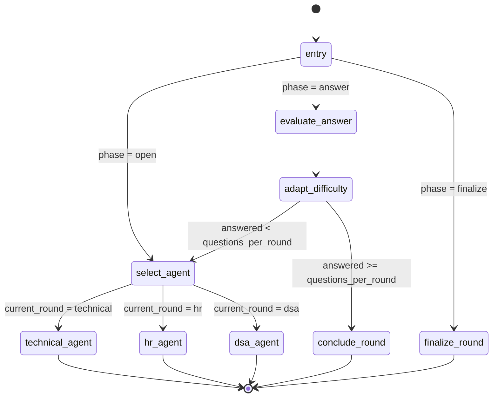
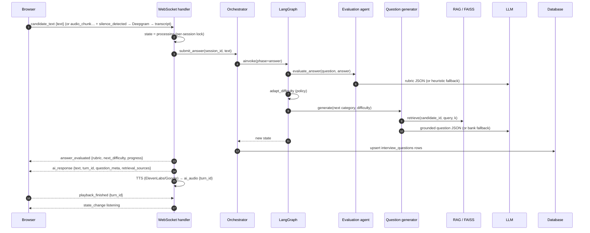

# System Architecture

Callback Rehearsal is a two-tier web application: a React single-page app and a FastAPI backend that hosts the
LangGraph interview engine, the RAG pipeline, the voice pipeline and persistence. All diagrams below reflect the
code in this repository (`backend/agents/interview_graph.py`, `backend/api/websocket.py`, `backend/services/`).

## 1. High-level architecture

```mermaid
graph LR
    subgraph Client["React SPA (Vite · Tailwind)"]
        UI[Pages: Dashboard · Resume · Setup · Interview Room · DSA Workspace · Results · History · Profile]
        WS[useWebSocket + useAudioCapture]
        API[api/endpoints.js · axios + refresh mutex]
    end

    subgraph Backend["FastAPI backend"]
        REST[REST routers<br/>auth · candidates · interviews · dsa · reports · dashboard · practice · debrief]
        WSE[WebSocket /ws/interview/{id}<br/>state machine · turn ids · STT/TTS]
        ORCH[InterviewOrchestrator<br/>session store · persistence · locks]
        GRAPH[LangGraph turn graph]
        subgraph Agents
            TA[Technical agent]
            HA[HR agent]
            DA[DSA agent]
            EA[Evaluation agent]
            RA[Report agent]
            QG[Question generator]
            POL[Difficulty policy]
        end
        RAG[RAGService<br/>chunker · FAISS IndexIDMap2]
        LLM[LLMService<br/>Groq · Gemini · unavailable]
        EMB[Embeddings<br/>Gemini · hashing fallback]
        STT[Deepgram STT]
        TTS[ElevenLabs TTS<br/>Google TTS fallback]
    end

    subgraph Data
        PG[(PostgreSQL / SQLite)]
        FS[(FAISS store on disk)]
        UP[(uploads/ resumes + PDFs)]
    end

    UI --> API --> REST
    WS <--> WSE
    REST --> ORCH
    WSE --> ORCH
    ORCH --> GRAPH
    GRAPH --> TA & HA & DA & EA
    TA & HA & DA --> QG --> RAG
    EA --> POL
    QG & EA & RA --> LLM
    RAG --> EMB --> FS
    REST --> RA
    WSE --> STT & TTS
    ORCH --> PG
    REST --> PG
    REST --> UP
```

## 2. LangGraph interview graph

Every interaction with the engine is one `graph.ainvoke(state)` call. The `phase` field selects the entry path;
`current_round` selects the agent. Agents never call each other.



| Node | Responsibility |
|---|---|
| `entry` / `select_agent` | Routing-only nodes (conditional edges on `phase`, `current_round`). |
| `technical_agent`, `hr_agent`, `dsa_agent` | Persona framing + `QuestionGenerator.generate()` with RAG context; append the question record and the spoken intro on the first question. |
| `evaluate_answer` | `EvaluationAgent.evaluate_answer()` on the pending question; optional resume context for consistency checks; stores rubric scores, evidence and `evaluation_source`. |
| `adapt_difficulty` | Applies `DifficultyPolicy` → `current_difficulty` (no-op when the session config disables adaptivity). |
| `conclude_round` | Produces the closing sentence when the question limit is reached. |
| `finalize_round` | Aggregates evaluations (`aggregate_round`), computes filler-word communication analytics, stores `round_results`/`round_scores`, pops the next round or completes the interview and computes the overall score. |

The orchestrator persists each question record to `interview_questions` after every turn and can rebuild the
state from the database (`restore_session`) after a restart.

## 3. Data flow — one interview turn (text or voice)



## 4. Voice interaction states

`initializing → generating → speaking → listening → processing → generating → speaking → … → waiting → completed`,
with `error` reachable from any state. The server owns the state; the client mirrors it (`useWebSocket`) and
starts/stops the microphone on `listening`/non-listening transitions. Every interviewer turn carries a `turn_id`;
duplicate `ai_response` frames are ignored client-side and stale TTS tasks are dropped server-side when a newer
turn supersedes them.

## 5. RAG pipeline

```mermaid
flowchart LR
    PDF[Resume PDF/DOCX] --> P[PyMuPDF / python-docx]
    P --> S[Section detection<br/>summary · skills · projects · experience · education · certifications]
    S --> CH[Overlapping windows on bullet/sentence boundaries<br/>600 chars · 120 overlap]
    CH --> M[Chunk metadata<br/>candidate_id · section · chunk_index · offsets]
    M --> E[Embeddings<br/>Gemini text-embedding-004 or hashing fallback]
    E --> F[FAISS IndexIDMap2 · IndexFlatIP<br/>cosine on normalised vectors]
    Qry[Category + role + last answer] --> E
    F --> K[Top-k filtered by candidate_id<br/>and optional sections]
    K --> CTX[Context block with citations<br/>[source: projects#3 relevance=0.36]]
    CTX --> GEN[Question generator prompt]
    K --> SRC[retrieval_sources persisted per question]
```

## 6. Backend module map

```
backend/
├── main.py                     app factory, startup validation, idempotent PG migrations, routers
├── core/        config · database · models · schemas · security · timeutil · communication_analyzer
├── agents/      orchestrator · interview_graph · question_generator · evaluation_agent · difficulty_policy
│                tech_agent · hr_agent · dsa_agent · report_agent · resume_screener · practice_agent · debrief_agent
├── services/    llm_service · faiss_service · rag_service · resume_chunker · resume_parser · rate_limiter
│                embeddings/ (gemini, hashing) · stt/deepgram_service · tts/elevenlabs_service
├── api/         websocket.py · routes/{auth,candidates,interviews,dsa,reports,dashboard,practice,debrief}.py
├── alembic/     migrations (81db… → ff35… → a1b2c3d4e5f6)
├── tests/       pytest suite (57 tests)
└── experiments/ exp1…exp5, run_all.py, results/
```

## 7. Frontend module map

```
frontend/src/
├── App.jsx                  routes (lazy pages), AuthProvider, ToastProvider
├── api/                     client.js (axios + refresh mutex) · endpoints.js (typed API surface)
├── context/AuthContext.jsx  session bootstrap, silent refresh, login/register/logout
├── hooks/                   useWebSocket.js (v2 protocol) · useAudioCapture.js (MediaRecorder + silence detection)
├── components/ui/index.jsx  design system primitives (Button, Card, Badge, Input, Select, Toggle, Progress,
│                            ScoreRing, StatCard, Tabs, Modal, Tooltip, Skeleton, Empty/Error states, Toasts)
├── components/layout/       AppShell (sidebar + capability banner) · PublicNav · AuthLayout
└── pages/                   Landing · SignIn · SignUp · ForgotPassword · ResetPassword · VerifyEmail · Dashboard
                             Resume · InterviewSetup · InterviewRoom · DSARound · Results · History · Profile · QuickPractice
```

## 8. Deployment view

* **Development:** SQLite file database, local FAISS store, Vite dev server (5173) → FastAPI (8002).
* **Production:** PostgreSQL (docker-compose service on 5433 or managed), `alembic upgrade head`, uvicorn behind a
  TLS reverse proxy (`TRUSTED_PROXY=true`, `COOKIE_SECURE=true`, `ENABLE_DOCS=false`), static frontend build served
  by Vercel/nginx with `VITE_API_BASE_URL`/`VITE_WS_URL` pointing at the API.
* Secrets are environment variables only; `.env` is git-ignored.

## 9. Design decisions

| Decision | Rationale |
|---|---|
| One graph invocation per turn instead of a long-running graph with interrupts | WebSocket turns arrive asynchronously; per-turn invocation keeps the graph pure, testable and restart-safe while LangGraph still owns routing. |
| `IndexIDMap2` over a plain flat index | Enables deleting/replacing one candidate's chunks without re-embedding everything. |
| Feature-hashing embeddings as fallback | Keeps the RAG pipeline functional offline and in CI; the backend name is persisted so indexes are never mixed across backends. |
| Provenance flags everywhere (`generation_source`, `evaluation_source`, `screening_source`, `narrative_source`) | Fallbacks must never masquerade as AI judgements; the UI and PDF surface them. |
| Per-session asyncio lock in the WebSocket layer | Prevents double evaluation when `silence_detected` and typed text arrive together. |
