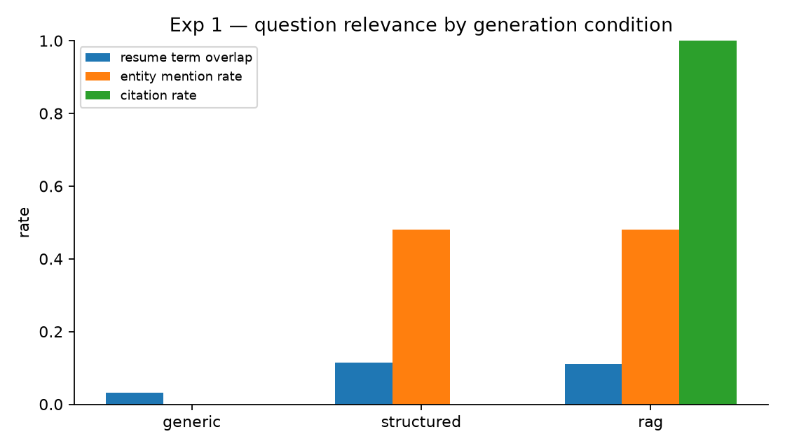
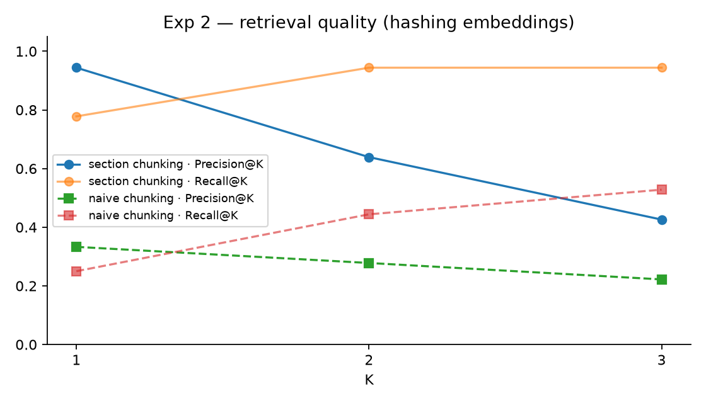
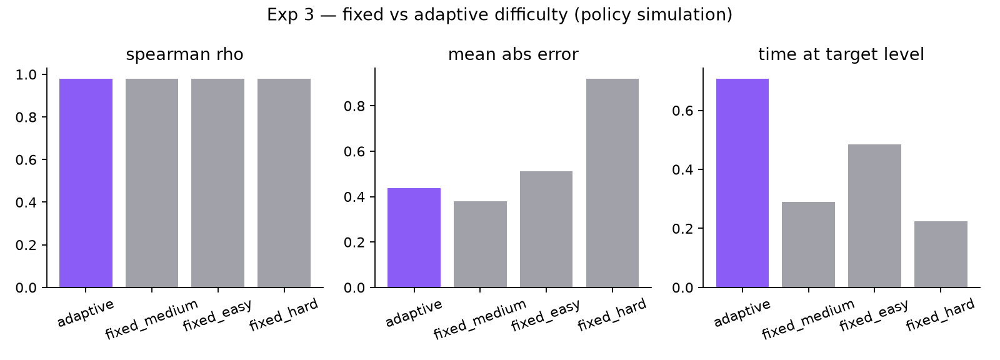

# Experimental Results

All numbers below were produced by the scripts in `backend/experiments/` on **2026-11-06** on the development
machine. Raw outputs: `backend/experiments/results/*.json`; plots: `backend/experiments/results/*.png`.

> **Run environment (recorded in every results file):** `llm_available = false` (no Groq/Gemini key present),
> `embedding_backend = hashing` (local lexical embeddings), adaptive thresholds 4 / 8, rubric 0.40/0.25/0.20/0.15.
> Consequently the question generator used the curated question bank and the evaluator used its heuristic path.
> Re-running `python experiments/run_all.py` with API keys configured re-executes the same protocol against the live
> model and overwrites these files with the new environment block. Nothing in this document is extrapolated.

## Experiment 1 — Generic vs resume-based question generation

Five synthetic candidates (ML graduate, backend, frontend, data engineer, DevOps), five technical questions each,
three conditions.

| Condition | Resume-term overlap (mean) | Entity-mention rate | Citation rate |
|---|---|---|---|
| generic (role only) | 0.032 | 0.00 | 0.00 |
| structured profile, no retrieval | 0.114 | 0.48 | 0.00 |
| structured profile + RAG | 0.110 | 0.48 | 1.00 |

*Resume-term overlap* = share of question tokens that appear in the candidate's resume; *entity-mention rate* =
share of questions naming one of the candidate's projects/companies/roles; *citation rate* = share of questions
that carry at least one retrieved resume chunk as a source reference.

**Observation.** Even in bank mode, structured resume data raises relevance (overlap ×3.5, 48 % of questions name a
real project versus 0 % generic). The RAG condition attaches sources to every question but does not change the
question text in bank mode because the bank cannot consume the retrieved context — the LLM path is what turns
retrieved chunks into question wording. The citation rate therefore measures the *grounding evidence available to
the model and the user*, not model behaviour, until the experiment is re-run with a key.



## Experiment 2 — Retrieval quality (Precision@K / Recall@K)

18 labelled queries (query → relevant resume section(s)) over the 5 resumes; relevance is judged at section level.

| Chunking | P@1 | P@2 | P@3 | R@1 | R@2 | R@3 | Cross-candidate leakage | Latency mean / p95 |
|---|---|---|---|---|---|---|---|---|
| **Section-aware (ours)** | **0.944** | 0.639 | 0.426 | **0.778** | **0.944** | **0.944** | 0 hits | 2.4 ms / 3.3 ms |
| Naive 300-char windows | 0.333 | 0.278 | 0.222 | 0.250 | 0.444 | 0.528 | 0 hits | 2.5 ms / 3.4 ms |

**Observation.** Section-aware chunking almost triples P@1 and recall at K=2 reaches 0.94 with the lexical backend.
Precision falls with K because most queries have a single relevant section and extra hits are counted as misses.
Per-candidate filtering produced zero leakage across 54 returned hits. These figures are for the hashing backend;
semantic embeddings are expected to help paraphrased queries, which the lexical backend cannot match.



## Experiment 3 — Fixed vs adaptive difficulty (policy simulation)

200 simulated candidates with latent ability θ ~ U(1.5, 9.5), six questions each, observed score
`N(θ − penalty(level), 1.2²)` clipped to [0, 10] with difficulty-weighted credit (0.85 / 1.0 / 1.15). The adaptive
condition uses the **production** `DifficultyPolicy`; fixed conditions keep one level.

| Condition | Spearman ρ (ability vs final score) | Mean abs error (score/10 vs θ) | Time at target level |
|---|---|---|---|
| **Adaptive (start medium)** | 0.978 | 0.436 | **0.707** |
| Fixed medium | 0.979 | **0.379** | 0.290 |
| Fixed easy | 0.978 | 0.513 | 0.485 |
| Fixed hard | 0.978 | 0.919 | 0.225 |

**Observation (honest reading).** Under this simple noise model all policies rank candidates almost perfectly
(ρ ≈ 0.98), so adaptivity does not improve *ranking*. Its measured benefit is **appropriateness**: adaptive
interviews spend 71 % of questions at the level matching the candidate's ability versus 29 % for fixed-medium,
while keeping the error comparable to the best fixed level and far below fixed-hard (0.44 vs 0.92). Fixed-medium
has the lowest MAE because the simulated score is centred on θ at medium difficulty by construction; this is a
property of the toy model, not evidence against adaptivity. A learning-outcome study with real candidates is
listed in `FUTURE_SCOPE.md`.



## Experiment 4 — AI vs human evaluation agreement

**Status: not run.** `backend/experiments/human_ratings.csv` was created as a template (columns: question, answer,
human_overall, human_technical, human_conceptual, human_completeness, human_communication). The script computes
Pearson r, Spearman ρ, MAE and quadratic-weighted Cohen's κ per criterion once at least three answers are rated by
humans. No synthetic human ratings were generated.

## Experiment 5 — Latency and completion (real persisted data)

Measured on the development database after the end-to-end smoke run (one completed session: DSA + technical,
degraded mode).

| Metric | Value |
|---|---|
| Questions persisted | 2 |
| Question generation latency (bank) | mean 7.5 ms |
| Answer evaluation latency (heuristic) | mean 0 ms (sub-millisecond) |
| Sessions by status | completed 1 · active 0 · cancelled 0 |
| Interview completion rate | 1.00 (n = 1) |
| Voice transcription latency | not measured (voice services not configured; pass `--log` with a server log containing `stt_latency_ms`) |

**Observation.** These latencies characterise the degraded path only. With a live LLM the generation and evaluation
latencies become network-bound (typically seconds); the same script reports them from `interview_questions` without
modification, split by `evaluation_source`.

## Reproducing

```bash
cd backend
venv/Scripts/python experiments/run_all.py                      # all experiments + plots
venv/Scripts/python experiments/exp5_latency.py --db "<DATABASE_URL>" --log backend.log
```

## Threats to validity

* Synthetic resumes and labelled queries were authored by the developer; section-level relevance labels are coarse.
* Experiments 1 and 2 ran with lexical embeddings and bank questions; LLM-path results may differ substantially.
* Experiment 3 is a simulation of the policy, not of candidates.
* Experiment 5 has n = 1 session; it demonstrates the measurement pipeline rather than a population estimate.
